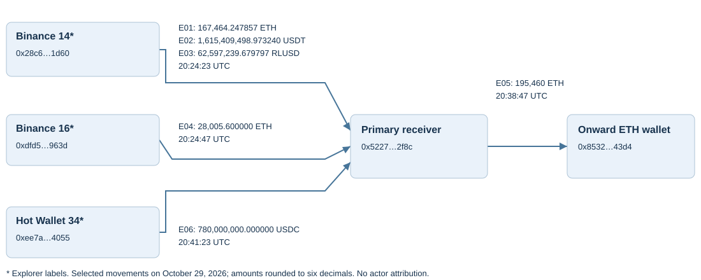

# Binance October 2026 — Developing incident

## Initial Ethereum trace and freeze-verification leads

**McLean Lipschutz · Public-source reconstruction · Incident date: October 29, 2026**

This is a starter investigation workbook and bounded trace of selected Ethereum movements associated with the publicly reported Binance security incident. It is not a complete loss assessment. Public reporting describes a developing incident and changing freeze totals; reported freezes are kept separate from verified fund-flow edges. No original case participation, Chainalysis Reactor use, actor identification, or asset recovery is claimed. Research, drafting, and data validation were assisted by AI.

The first version contains **six selected movements across four transactions**, checked against Blockscout and Etherscan, plus Blockscout metadata for one EIP-7702 authorization transaction. Raw log fields, an execution trace, factual explorer extracts, retrieval times, and hashes are preserved in [the evidence snapshot](evidence/snapshot.json). Snapshot retrieval timestamps are UTC; all incident times below are October 29 UTC.

## Selected fund movements

| Edge | UTC time | Asset | Exact quantity | Source role | Destination role |
|---|---|---|---:|---|---|
| E01 | 20:24:23 | ETH | 167,464.247856558836135296 | Binance 14 label | Primary receiver |
| E02 | 20:24:23 | USDT | 1,615,409,498.973240 | Binance 14 label | Primary receiver |
| E03 | 20:24:23 | RLUSD | 62,597,239.679797044969015518 | Binance 14 label | Primary receiver |
| E04 | 20:24:47 | ETH | 28,005.600000000000000000 | Binance 16 label | Primary receiver |
| E05 | 20:38:47 | ETH | 195,460.000000000000000000 | Primary receiver | ETH onward receiver |
| E06 | 20:41:23 | USDC | 780,000,000.000000 | Binance Hot Wallet 34 label | Primary receiver |

The two selected initial ETH receipts total **195,469.847856558836135296 ETH**. E05 is onward movement of funds, not an additional incident loss. These observations do not establish a current balance or complete historical balance reconciliation. No cross-asset dollar total is calculated; no price source or valuation time has been selected.



The picture is a static starter view with rounded labels. Full addresses, exact amounts, and transaction hashes are in the workbook and CSV files. Address labels are external explorer annotations, not independent proof of real-world ownership. The operator and delegation target appear in the node register but are not drawn as money recipients unless the transfer evidence establishes that role.

## Investigative findings

**The token sender can differ from the transaction target.** E06's outer transaction is sent by the operator to Binance 14, but the USDC event records `0xee7ae85f2fe2239e27d9c1e23fffe168d63b4055` as the token sender. Etherscan labels it Binance Hot Wallet 34. The graph uses the event's actual endpoints and preserves the transaction-level endpoints separately.

**Native ETH can move inside a zero-value transaction.** E01 is an internal call from Binance 14 to the primary receiver. The transaction envelope's ETH value is zero. The successful internal transfer and its amount were checked against Etherscan's native-transfer display. The sweep also contains failed internal calls; only selected completed movements are included.

**Authorization entries are not all successfully applied.** The captured type-4 transaction at 20:20:59 contains 50 authorization entries. Blockscout marks one `ok` and 49 `invalid_nonce`. The study does not claim that 50 delegations took effect or that possession of a valid authorization proves how the signing system was compromised. Signature recovery and state execution have not been independently replayed. [EIP-7702](https://eips.ethereum.org/EIPS/eip-7702) is the specification reference for follow-up.

**Token identity requires the contract address.** USDT, USDC, and RLUSD are checked against issuer documentation listed in [sources.md](sources.md). The sweep's Blockscout transaction summary is truncated. Both log pages were obtained, but this first ledger intentionally includes only ETH, USDT, and RLUSD from that sweep. Other tokens remain follow-up work.

**Reported freezes remain verification leads.** The supplied screenshot reports about 971 million USDT and 823 million USDC frozen. Reuters subsequently reported a Binance-stated aggregate of $2.54 billion frozen. These figures differ in scope and time and must not be summed. No freeze receipts or historical frozen balances have been validated in this package. A freeze is not a transfer to an issuer and is not proof of restitution. [Reporting source](https://www.reuters.com/legal/transactional/tether-circle-freeze-238-billion-after-binance-reports-security-incident-2026-10-29/)

## Files and next steps

- [Excel tracing workbook](Binance_2026_Tracing_Workbook.xlsx): overview, editable Transfers ledger, linked Graph Edges, Wallets, and Leads.
- [Graph nodes](nodes.csv) and [directed edges](edges.csv): import-ready seed files with full addresses and transaction identifiers.
- [Workbook and graph instructions](tracing-guide.md): how to extend the ledger, export the graph, and preserve precision.
- [Evidence snapshot](evidence/snapshot.json): factual extracts with provenance and raw log/trace fields.
- [Offline verifier](verify_trace.py): checks extracted-body integrity, explorer agreement, exact amounts, graph references, and scope limits.
- [Sources and transaction register](sources.md): identifiers and evidence boundaries.

Run from the repository root:

```bash
python3 binance-2026-developing/verify_trace.py
```

Priority follow-up is to verify issuer freeze transactions and balances at those blocks, trace the ETH onward receiver, complete the other token/chain branches, and verify the operator's reported Tornado Cash funding. Mixer exposure does not establish a deposit-to-withdrawal link or DPRK attribution. The screenshot author's claimed $835 million tracing work is not adopted as this portfolio's work.

[Back to portfolio](../README.md)
